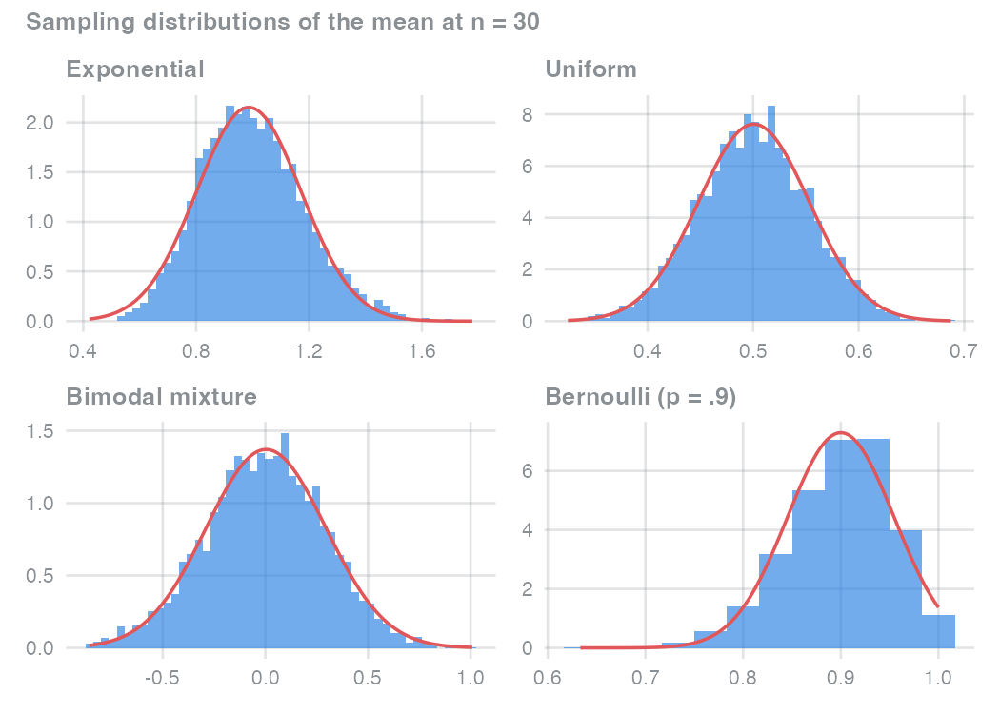

```{=html}
<style>
/* let the OJS input panel follow the site's light/dark background */
.quarto-ojs-panel-input, .panel-input {
  background: transparent !important;
  border-color: #8a8f9440 !important;
}
</style>
```

*This is the first post in a series on probability distributions as claims about psychological processes: what a distribution says about the mechanism that generated your data, and what it does not.*

In 1989, Theodore Micceri collected 440 score distributions from real psychological and educational measurement (ability tests, personality inventories, achievement data) and checked each one against the normal distribution [@micceriUnicornNormalCurve1989]. Not a single one passed. Zero of 440. He titled the paper "The unicorn, the normal curve, and other improbable creatures," and the point of the title was blunt: in psychology, the normal distribution is universally assumed and never actually observed. Decades later, nothing suggests the finding has expired. Real psychological data are as skewed, lumpy, bounded, and heavy-tailed as they were then.

So psychology's favourite distribution describes almost none of psychology's data. That sounds like a scandal. I would argue it is something more useful: a clue — about what the normality assumption actually says, and about what our measures are made of.

## An assumption that is always false and rarely matters

Virtually every t-test, ANOVA, and linear regression in the field relies on some form of normality. Which form, exactly, differs by method, and that distinction carries most of this post. Yet the tension is real: an assumption that is essentially always violated underlies methods that demonstrably work. In extensive simulations across realistic violation scenarios, @kniefViolatingNormalityAssumption2021 found Gaussian models to be remarkably robust, often more trustworthy than the workarounds researchers reach for when a normality test comes back significant. An assumption that is always false but rarely matters is not a paradox. It means the assumption is not about what we think it is about. It also holds under conditions that are common but, as the final sections show, not universal.

Consider the most familiar case in cognitive psychology: response times.

```{r}
#| label: setup
#| code-summary: "Packages and plot theme"
library(ggplot2)
library(patchwork)

accent_blue <- "#2780e3"
accent_red  <- "#e15759"
text_grey   <- "#8a8f94"

theme_blog <- function(base_size = 13) {
  theme_minimal(base_size = base_size) +
    theme(
      text              = element_text(colour = text_grey),
      axis.text         = element_text(colour = text_grey),
      plot.title        = element_text(colour = text_grey, face = "bold", size = rel(0.95)),
      strip.text        = element_text(colour = text_grey, face = "bold"),
      panel.grid.minor  = element_blank(),
      panel.grid.major  = element_line(colour = "#8a8f9440"),
      plot.background   = element_rect(fill = "transparent", colour = NA),
      panel.background  = element_rect(fill = "transparent", colour = NA),
      legend.background = element_rect(fill = "transparent", colour = NA)
    )
}
theme_set(theme_blog())

density_hist <- function(x, bins = 50) {
  geom_histogram(aes(y = after_stat(density)),
                 bins = bins, fill = accent_blue, alpha = 0.65)
}
normal_overlay <- function(x, robust = FALSE) {
  s <- if (robust) IQR(x) / 1.349 else sd(x)
  stat_function(fun = dnorm, args = list(mean = median(x), sd = s),
                colour = accent_red, linewidth = 0.8)
}
```

```{r}
#| label: fig-raw-vs-means
#| fig-height: 3.5
#| fig-cap: "Left: 10,000 single-trial response times from a right-skewed generator. Right: 5,000 per-participant mean RTs (80 trials each), with a normal curve fitted to their mean and standard deviation."
#| fig-alt: "Two histograms. The left histogram of single-trial response times is strongly right-skewed. The right histogram of per-participant mean response times is symmetric and closely follows an overlaid normal curve."
#| code-summary: "Simulate raw and aggregated RTs (F1)"
set.seed(1989)
sim_rt <- function(n) rnorm(n, mean = 450, sd = 60) + rexp(n, rate = 1 / 150)

raw_rt  <- sim_rt(10000)
mean_rt <- replicate(5000, mean(sim_rt(80)))

p_raw <- ggplot(data.frame(rt = raw_rt), aes(rt)) +
  density_hist(raw_rt, bins = 60) +
  labs(title = "10,000 single-trial RTs", x = "RT (ms)", y = NULL)

p_mean <- ggplot(data.frame(rt = mean_rt), aes(rt)) +
  density_hist(mean_rt, bins = 60) +
  normal_overlay(mean_rt) +
  labs(title = "5,000 mean RTs (80 trials each)", x = "Mean RT (ms)", y = NULL)

p_raw + p_mean
```

Single-trial response times (left) are strongly right-skewed: responses cannot be faster than some physiological minimum, but they can always be slower. This is the kind of distribution Micceri catalogued. The per-participant *mean* response times (right) are a different animal: symmetric, and tracked closely by a normal curve. The raw data never changed. What changed is which quantity you look at, and that is the resolution of the puzzle.

## Three claims that share one name

"The data must be normal" is not one claim. It is at least three:

1. **Raw scores are normal in the population.** This is what an exact small-sample t-test assumes.
2. **Residuals are normal.** This is what linear regression assumes, and it concerns the deviations from the model, not the outcome itself.
3. **The sampling distribution of an estimator is normal.** This is what confidence intervals and p-values on means and regression coefficients actually rest on at moderate-to-large samples.

Only the third claim gets rescued by a theorem as sample size grows. In other words, when researchers say "normality doesn't matter much," they are implicitly talking about claim 3, and when they test normality on their raw scores, they are usually testing claim 1, which their analysis may never have made. Before unpacking all three, it helps to meet the mechanism that does the rescuing.

## The normal is the distribution of aggregation

Add up many small, independent contributions, none of which dominates the total, and the distribution of the sum approaches a normal — no matter what the contributions themselves look like. That is the central limit theorem (CLT), stated without symbols. It makes no claim about your raw data. It makes a claim about what happens to *sums and averages* of your raw data.

Rather than asking you to trust the theorem, the module below lets you test it adversarially. Pick the least normal parent distribution on offer, then drag the sample size up and watch what happens to the distribution of 5,000 sample means.

```{ojs}
//| echo: false
//| panel: input
viewof parent = Inputs.select(
  new Map([
    ["Exponential (RT-like skew)", "exp"],
    ["Uniform", "unif"],
    ["Bimodal mixture", "bimodal"],
    ["Skewed Bernoulli (p = 0.9)", "bern"]
  ]),
  { label: "Parent distribution", value: "exp" }
)
viewof n = Inputs.range([1, 100], { step: 1, value: 5, label: "Sample size n" })
viewof redraw = Inputs.button("Draw again")
```

```{ojs}
//| echo: false
samplers = {
  const lo = d3.randomNormal(-1.5, 0.5), hi = d3.randomNormal(1.5, 0.5);
  return {
    exp: d3.randomExponential(1),
    unif: d3.randomUniform(0, 1),
    bimodal: () => (Math.random() < 0.5 ? lo() : hi()),
    bern: () => (Math.random() < 0.9 ? 1 : 0)
  };
}

singles = {
  redraw;
  const f = samplers[parent];
  return Float64Array.from({ length: 5000 }, f);
}

means = {
  redraw;
  const f = samplers[parent];
  return Float64Array.from({ length: 5000 }, () => {
    let s = 0;
    for (let i = 0; i < n; i++) s += f();
    return s / n;
  });
}

// density-normalized histogram bins, so the normal curve overlays on the same scale
meansHist = {
  const bins = d3.bin().thresholds(50)(means);
  const total = means.length;
  return bins
    .filter((b) => b.x1 > b.x0)
    .map((b) => ({ x0: b.x0, x1: b.x1, density: b.length / (total * (b.x1 - b.x0)) }));
}

normalCurve = {
  const m = d3.mean(means), s = Math.max(d3.deviation(means), 1e-9);
  const lo = d3.min(means), hi = d3.max(means);
  const step = (hi - lo) / 200 || 1e-3;
  return d3.range(lo, hi + step, step).map((x) => ({
    x, y: Math.exp(-0.5 * ((x - m) / s) ** 2) / (s * Math.sqrt(2 * Math.PI))
  }));
}
```

```{ojs}
//| echo: false
Plot.plot({
  height: 110,
  width,
  style: { background: "transparent" },
  x: { label: "5,000 single draws from the parent distribution" },
  y: { axis: null },
  marks: [
    Plot.rectY(singles, Plot.binX({ y: "proportion" },
      { x: (d) => d, fill: "#2780e3", fillOpacity: 0.5, thresholds: 60 }))
  ]
})
```

```{ojs}
//| echo: false
Plot.plot({
  height: 300,
  width,
  style: { background: "transparent" },
  x: { label: `Means of 5,000 samples, each of size n = ${n}` },
  y: { label: "Density" },
  marks: [
    Plot.rect(meansHist, { x1: "x0", x2: "x1", y1: 0, y2: "density",
      fill: "#2780e3", fillOpacity: 0.65 }),
    Plot.line(normalCurve, { x: "x", y: "y", stroke: "#e15759", strokeWidth: 2 })
  ]
})
```

<noscript></noscript>

At n = 1 you see the parent distribution itself, because the "mean" of one observation is that observation. By n = 30, every parent on offer (including the bimodal mixture, which no one would mistake for normal) produces a bell-shaped distribution of means. The skewed Bernoulli is the most instructive: single draws are just 0s and 1s, about as non-normal as data get, yet their averages line up under the normal curve. Try to break it.

This is why the mean RT panel in the first figure looked so tame. A mean over 80 trials is a sum of many roughly independent contributions, scaled by a constant, and the CLT does the rest. However, "roughly" is doing quiet work in that sentence: trials within a session drift with practice and fatigue, and consecutive trials are sequentially dependent, so the CLT's independence condition holds only approximately in real experiments [@sawadaConditionsCentralLimitTheorem2021]. The violations are usually mild. They are not absent, and for short task blocks they are worth taking seriously.

This post is the first pass at a theme that runs through the whole series: **a probability distribution is a claim about the process that generated the data.** The normal is what aggregation produces. Assuming it is justified not when a histogram happens to look bell-shaped, but when the quantity you model is plausibly a sum or average of many small, independent contributions.

## One experiment, three normality questions

Concretely, consider a simulated two-condition experiment: 300 observations, a 150 ms difference between conditions, and within-condition noise with a standard deviation of 50 ms. The same dataset answers the three normality questions differently.

```{r}
#| label: fig-three-claims
#| fig-height: 7.5
#| fig-cap: "One simulated experiment, three different normality questions. Top: the raw outcome pooled across two conditions is bimodal. Middle: the residuals of the model y ~ condition are approximately normal. Bottom: the bootstrapped sampling distribution of the grand mean is normal and much narrower. Left column: histograms; right column: Q-Q plots of the same quantities."
#| fig-alt: "A three-by-two grid of plots. The top row shows a bimodal raw outcome whose Q-Q plot bends away from the reference line in an S shape. The middle row shows model residuals that are approximately normal with Q-Q points on the line. The bottom row shows a narrow, normal bootstrapped sampling distribution of the mean, also on the Q-Q line."
#| code-summary: "One dataset, three normality claims (F2)"
set.seed(1997)
n_obs     <- 300
condition <- rep(c("A", "B"), each = n_obs / 2)
y         <- 500 + 150 * (condition == "B") + rnorm(n_obs, 0, 50)

fit        <- lm(y ~ condition)
res        <- resid(fit)
boot_means <- replicate(2000, mean(sample(y, replace = TRUE)))

claim_row <- function(x, label, bins = 40) {
  d <- data.frame(x = x)
  h <- ggplot(d, aes(x)) +
    density_hist(x, bins = bins) +
    labs(title = label, x = NULL, y = NULL)
  q <- ggplot(d, aes(sample = x)) +
    stat_qq(colour = accent_blue, alpha = 0.4, size = 0.8) +
    stat_qq_line(colour = accent_red, linewidth = 0.7) +
    labs(x = NULL, y = NULL)
  list(h, q)
}

rows <- c(
  claim_row(y,          "Raw outcome, both conditions pooled"),
  claim_row(res,        "Residuals of y ~ condition"),
  claim_row(boot_means, "Sampling distribution of the mean (2,000 bootstraps)")
)
wrap_plots(rows, ncol = 2, byrow = TRUE)
```

The raw outcome (top row) is bimodal — and it *should* be. The two humps are the two conditions; the "non-normality" is the experimental effect itself. Testing the pooled outcome for normality punishes you for having found something. The residuals of the model `y ~ condition` (middle row) are approximately normal, because once the condition effect is accounted for, only the within-condition noise remains. The bootstrapped sampling distribution of the grand mean (bottom row) is normal and far narrower than either. Three questions, three answers, one dataset.

Critically, the quantity researchers most often test is the one their model never assumed. In a systematic review of clinical psychology research practice, @ernstRegressionAssumptionsClinical2017 found that assumption checks are routinely misdirected — including testing normality on the raw variables rather than on the residuals the regression model actually constrains. If you take one habit from this post: when your software offers you a normality test of the outcome, ask which of the three claims your analysis actually makes. (For a compact map of how the familiar tests are all linear models with the same residual assumption, see Jonas Lindeløv's [Common statistical tests are linear models](https://lindeloev.github.io/tests-as-linear/).)

::: {.callout-note collapse="true"}
## How to read a Q-Q plot

A quantile–quantile plot compares the quantiles of your data against the quantiles of a theoretical normal distribution with the same mean and variance. If the data are normal, the points fall on the diagonal reference line. Systematic bends are diagnostic: a C-shape signals skew, an S-shape signals tails that are too heavy or too light. Q-Q plots beat histograms for this job because binning can hide exactly the tail behaviour that matters — and summary statistics like kurtosis are harder to interpret than their reputation suggests [@decarloMeaningUseKurtosis1997].
:::

## A sum score is not a mean RT

If aggregation produces normality, questionnaire scores should be the best-behaved data in psychology: a 20-item scale total is a sum, after all. However, the CLT's conditions include *independence*, and scale items are correlated by design — they were selected precisely because they measure the same construct. Adding a 21st item does not contribute a fresh, independent piece of noise; it mostly re-measures the shared trait. As the number of items grows, the total becomes increasingly dominated by that single common component, which is the opposite of the CLT's requirement that no single contribution dominate the sum.[^k2] In other words, aggregation does not normalize a sum score. Whatever distribution the total has, it inherits from the distribution of the latent trait and from how the items map onto it: item difficulties, floors, and ceilings. Factor scores go a step further still: their apparent normality is typically imposed by the measurement model's identification assumptions rather than discovered in the data.

This resolves most of the unicorn puzzle from the opening. Micceri's 440 distributions were dominated by exactly such composite measures: ability, achievement, and psychometric totals. Their non-normality is not noise waiting to be averaged away. It reflects the generative architecture of the measures themselves, which is why no amount of appeal to the CLT would have made those histograms bell-shaped.

[^k2]: Under classical test theory, each item score is a true-score contribution plus error, $X_i = T + E_i$. For a k-item total with a shared true score and independent errors, $\mathrm{Var}(\sum X_i) = k^2\,\mathrm{Var}(T) + k\,\mathrm{Var}(E)$: the shared component grows quadratically with scale length while the independent component grows only linearly, so lengthening a scale makes the total *more* dominated by the single common term, not less.

## Slowed convergence is not broken convergence

When the rescue fails, it fails in two different ways, and they call for different responses.

```{r}
#| label: fig-slowed-broken
#| fig-height: 5.5
#| fig-cap: "Top row (slowed convergence): means of exponential samples are visibly skewed at n = 5 but close to normal at n = 100. Bottom row (broken convergence): means of t(1.5) samples — a heavy-tailed parent with infinite variance — stay too peaked with too-heavy tails, and going from n = 5 to n = 100 does not fix it. The overlaid normal curve is matched to each panel's median and IQR; the bottom panels are truncated at ±4 for display."
#| fig-alt: "A two-by-two grid of histograms with normal overlays. In the top row, exponential sample means look skewed at n equals 5 and normal at n equals 100. In the bottom row, means of a heavy-tailed t distribution remain sharply peaked with heavy tails at both sample sizes, deviating clearly from the overlaid normal curve."
#| code-summary: "Slowed vs. broken convergence (F3)"
set.seed(2021)
mean_of <- function(rfun, n, reps = 5000) replicate(reps, mean(rfun(n)))

panels <- list(
  list(x = mean_of(\(n) rexp(n, 1), 5),        title = "Slowed: exponential, n = 5",  lim = NULL),
  list(x = mean_of(\(n) rexp(n, 1), 100),      title = "Slowed: exponential, n = 100", lim = NULL),
  list(x = mean_of(\(n) rt(n, df = 1.5), 5),   title = "Broken: t(1.5), n = 5",       lim = c(-4, 4)),
  list(x = mean_of(\(n) rt(n, df = 1.5), 100), title = "Broken: t(1.5), n = 100",     lim = c(-4, 4))
)

plots <- lapply(panels, function(p) {
  d <- data.frame(x = p$x)
  g <- ggplot(d, aes(x)) +
    geom_histogram(aes(y = after_stat(density)),
                   bins = if (is.null(p$lim)) 60 else 200,
                   fill = accent_blue, alpha = 0.65) +
    normal_overlay(p$x, robust = TRUE) +
    labs(title = p$title, x = NULL, y = NULL)
  if (!is.null(p$lim)) g <- g + coord_cartesian(xlim = p$lim)
  g
})
wrap_plots(plots, ncol = 2)
```

*Slowed* convergence (top row) is the benign failure. The more skewed the parent distribution, the larger the sample the CLT needs — a relationship the Berry–Esseen theorem makes precise by tying the approximation error to the parent's skewness and to sample size. Means of five exponential observations are visibly skewed; means of one hundred are not. The response is boring and effective: more observations.

*Broken* convergence (bottom row) is the failure more observations cannot fix. The parent here is a t distribution with 1.5 degrees of freedom — heavy-tailed enough that its variance is infinite, so single observations can be arbitrarily dominant. That violates the CLT's no-dominant-term requirement (the Lindeberg condition), and the consequence is visible: going from n = 5 to n = 100 buys nothing. The distribution of means stays too peaked in the middle with tails the normal curve cannot reach. Real data rarely follow a textbook t(1.5), but the same structure appears whenever a handful of extreme observations (contaminated trials, unbounded outliers, mixture populations) can dominate a sum. Skew slows the rescue; dominant observations cancel it.

Two boundary notes to keep in view. Bounded outcomes such as proportions and rating scales pile up against their floors and ceilings, and near a boundary no aggregation argument makes a normal model natural — these get their own generative stories later in this series. And homoscedasticity is a separate assumption entirely: no normality check, on any of the three quantities, tells you whether the variance is constant.

## What to check instead

| Your analysis | The normality that matters | What to look at |
|---|---|---|
| Exact t-test at small n | Raw scores in the population (claim 1) | Raw-data diagnostics; consider methods that drop the assumption |
| Regression / ANOVA / t-test at moderate n | Residuals (claim 2), estimator asymptotics (claim 3) | Residual Q-Q plot — not the outcome; sample size vs. skew |
| Any mean-based estimate | Sampling distribution of the estimator (claim 3) | Skew slows convergence; dominant outliers break it; bootstrap when in doubt |

: Which normality claim your analysis actually makes {#tbl-decision}

One caution before this series leans harder on generative thinking: the mapping between mechanisms and distributions is many-to-many. Normality is compatible with many aggregation stories, and non-normal data are compatible with many architectures. A distribution constrains the set of plausible processes; it does not identify one.

With that caution on record, the constructive move is to ask of every measure: *what kind of process could have generated this?* Different generative architectures produce different canonical distributions, and each answer suggests a model family:

| If the observation is… | …the canonical distribution is | Series |
|---|---|---|
| A sum or average of many independent contributions | Normal | this post |
| A continuous tendency pushed through a discrete threshold | Binomial with probit/logit link | next post |
| A count of events in a window | Poisson / negative binomial | Series 2 |
| A wait for several processing stages to finish | Gamma | Series 2 |
| An angular error in a 2D representation | Von Mises | Series 2 |

: Generative architectures and their distributions {#tbl-spine}

Taken together: the normal distribution is not psychology's default. It is the signature of one specific generative architecture, the aggregation of many small independent influences, and its famous robustness extends exactly as far as that architecture does. Micceri's unicorn was never a scandal about our statistics. It was a fact about our measures, most of which are not built by aggregation at all.

The next post takes the same question to binary data. What does an accuracy rate claim about the process that produced it? The answer turns out to have signal detection theory hiding inside it.

```{r}
#| label: clt-fallback
#| include: false
set.seed(30)
parents <- list(
  "Exponential"        = function(n) rexp(n, 1),
  "Uniform"            = function(n) runif(n),
  "Bimodal mixture"    = function(n) ifelse(runif(n) < 0.5,
                                            rnorm(n, -1.5, 0.5), rnorm(n, 1.5, 0.5)),
  "Bernoulli (p = .9)" = function(n) rbinom(n, 1, 0.9)
)
fb <- lapply(names(parents), function(nm) {
  m <- replicate(5000, mean(parents[[nm]](30)))
  hist_layer <- if (nm == "Bernoulli (p = .9)") {
    # means live on the discrete grid k/30 — align bins to it
    geom_histogram(aes(y = after_stat(density)), binwidth = 1 / 30,
                   boundary = -1 / 60, fill = accent_blue, alpha = 0.65)
  } else {
    density_hist(m, bins = 50)
  }
  ggplot(data.frame(x = m), aes(x)) +
    hist_layer +
    normal_overlay(m) +
    labs(title = nm, x = NULL, y = NULL)
})
fallback <- wrap_plots(fb, ncol = 2) +
  plot_annotation(title = "Sampling distributions of the mean at n = 30",
                  theme = theme_blog())
ggsave("clt-fallback.png", fallback, width = 7, height = 5, dpi = 150, bg = "white")
```
