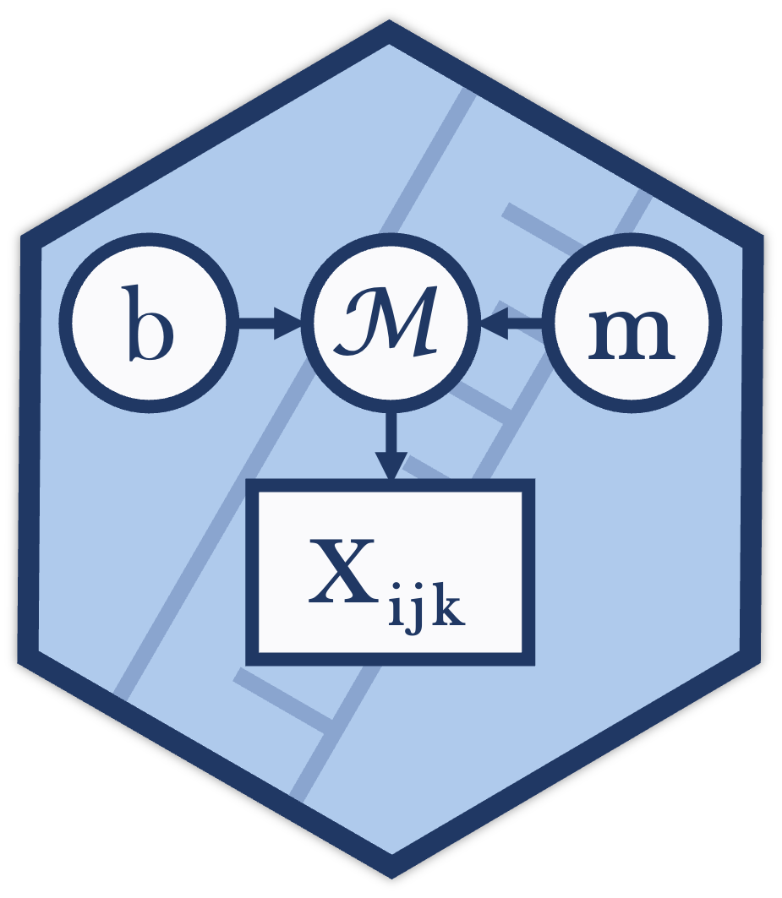
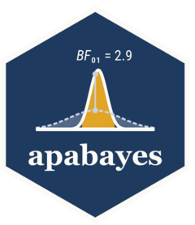
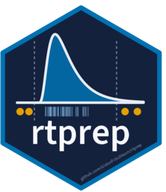

In addition to my research, I develop open source software. Each package below started as a problem in my own work: fitting cognitive measurement models without writing a custom sampler, checking that a model can recover what it claims to measure, reporting the result in APA style, deciding what to do with response times before analysing them, and getting data out of JATOS and Prolific without a token ending up in a script.

## Cognitive measurement modelling

---

### bmm
:::: {.columns}

::: {.column width="20%"}

:::

::: {.column width="5%"}
:::

::: {.column width="75%"}

**bmm: Bayesian Measurement Models for Cognitive Processes**

Role: Lead author and maintainer

[Website](https://venpopov.com/bmm/index.html){.btn .btn-outline-primary .btn-sm role="button"}
[GitHub](https://github.com/popov-lab/bmm){.btn .btn-outline-primary .btn-sm role="button"}
[Issues](https://github.com/popov-lab/bmm/issues){.btn .btn-outline-primary .btn-sm role="button"}

:::

::::

`bmm` is an R package I co-develop with [Ven Popov](https://venpopov.com) for fitting cognitive measurement models in a hierarchical Bayesian framework. It builds on [`brms`](https://paul-buerkner.github.io/brms/) and Stan, and uses the same formula syntax. If you know brms, you already know most of how bmm works.

The current focus is measurement models for  working memory. `bmm` implements multiple measurement models in one place, with a consistent interface across model families.

#### Install

```r
# From CRAN
install.packages("bmm")

# Development version
# install.packages("pak")
pak::pak("popov-lab/bmm")
```

#### Selected References

- Frischkorn, G. T., & Popov, V. (2025). A tutorial for estimating Bayesian hierarchical mixture models for visual working memory tasks: Introducing the Bayesian Measurement Modeling (bmm) package for R. *Behavior Research Methods, 57*(5), 144. [https://doi.org/10.3758/s13428-025-02643-0](https://doi.org/10.3758/s13428-025-02643-0){target="_blank"}

---

### bmm model explorer

:::: {.columns}

::: {.column width="20%"}

:::

::: {.column width="5%"}
:::

::: {.column width="75%"}

**bmm model explorer: see what a measurement model predicts before you fit it**

Role: Author

[Open the explorer](https://www.gfrischkorn.org/bmm-explorer/){.btn .btn-outline-primary .btn-sm role="button"}
[GitHub](https://github.com/GidonFrischkorn/bmm-explorer){.btn .btn-outline-primary .btn-sm role="button"}
[Issues](https://github.com/GidonFrischkorn/bmm-explorer/issues){.btn .btn-outline-primary .btn-sm role="button"}

:::

::::

One page per bmm model, twelve so far: sliders for the model's parameters, a plot of the predicted responses, an illustration of the task, and a panel that shows what the model predicts when the task changes (set size, number of response candidates) while the parameters stay fixed. Everything runs in the browser; the densities are JavaScript ports of bmm's own functions, held to fixtures that bmm generated. Useful for teaching, for choosing priors, and for checking an intuition before writing a line of R.

---

### bmmtools

:::: {.columns}

::: {.column width="20%"}

:::

::: {.column width="5%"}
:::

::: {.column width="75%"}

**bmmtools: Validate Cognitive Measurement Models Fitted with bmm**

Role: Author and maintainer

[Website](https://www.gfrischkorn.org/bmmtools/){.btn .btn-outline-primary .btn-sm role="button"}
[GitHub](https://github.com/GidonFrischkorn/bmmtools){.btn .btn-outline-primary .btn-sm role="button"}
[Issues](https://github.com/GidonFrischkorn/bmmtools/issues){.btn .btn-outline-primary .btn-sm role="button"}

:::

::::

bmm builds and fits a model; `bmmtools` checks that the model works before anyone trusts it on real data. Every check is the same loop, simulate data from known values, fit, score, with a different scorer each time: parameter recovery on a grid of generating values, prior predictive checks on the observable scale, recovery of between-subject correlations and factor structures, simulation-based calibration, and cross-checks against closed-form estimators or published values.

*Version 0.2.0, lifecycle experimental; GitHub only.*

#### Install

```r
# install.packages("pak")
pak::pak("GidonFrischkorn/bmmtools")
```

---

### apabayes

:::: {.columns}

::: {.column width="20%"}

:::

::: {.column width="5%"}
:::

::: {.column width="75%"}

**apabayes: Report Bayesian and Structural Equation Models in APA Style**

Role: Author and maintainer

[Website](https://www.gfrischkorn.org/apabayes/){.btn .btn-outline-primary .btn-sm role="button"}
[GitHub](https://github.com/GidonFrischkorn/apabayes){.btn .btn-outline-primary .btn-sm role="button"}
[Issues](https://github.com/GidonFrischkorn/apabayes/issues){.btn .btn-outline-primary .btn-sm role="button"}

:::

::::

`apabayes` writes the inline strings and tables that APA 7 asks for, inside [apaquarto](https://github.com/wjschne/apaquarto) documents, for `brms` and `bmm` fits, `lavaan` and `blavaan` models, `brms::hypothesis()` output, `loo` comparisons, Bayes factors, and `emmeans` contrasts. The numbers come from the model's own package and from the easystats packages; apabayes selects, arranges, and formats them.

*In development; 0.1.0 is the first planned release.*

#### Install

```r
# install.packages("pak")
pak::pak("GidonFrischkorn/apabayes")
```

---

## Research workflow

---

### rtprep
:::: {.columns}

::: {.column width="20%"}

:::

::: {.column width="5%"}
:::

::: {.column width="75%"}

**rtprep: Screening, Trimming, and Aggregating Response Time Data**

Role: Author and maintainer

[Website](https://www.gfrischkorn.org/rtprep/){.btn .btn-outline-primary .btn-sm role="button"}
[GitHub](https://github.com/GidonFrischkorn/rtprep){.btn .btn-outline-primary .btn-sm role="button"}
[Issues](https://github.com/GidonFrischkorn/rtprep/issues){.btn .btn-outline-primary .btn-sm role="button"}

:::

::::

Every response time analysis makes an exclusion decision, and most inherit it by convention: 200 ms and 3 s because that is what the last paper did, ±2.5 *SD* because that is what the field does. Better methods exist, but they are scattered across packages, and each returns a different kind of object — a trimmed data frame, a vector of per-trial probabilities, a set of summary statistics. That makes the choices impossible to compare.

`rtprep` gives them one interface. Absolute cutoffs, standard deviation and median absolute deviation criteria, recursive moving criteria, and model-based mixture flagging all return the same per-trial object, and diagnostics report what each rule removed and where two defensible rules disagree on your own data. The package also generates response times with contaminants of known type, so a pipeline can be tested against ground truth rather than trusted.

*On CRAN since October 2026 (version 0.1.0); the development version is on R-universe and GitHub.*

#### Install

```r
# From CRAN
install.packages("rtprep")

# Development version
# install.packages("pak")
pak::pak("GidonFrischkorn/rtprep")
```

---

### jatosr
:::: {.columns}

::: {.column width="20%"}

:::

::: {.column width="5%"}
:::

::: {.column width="75%"}

**jatosr: Download and Manage JATOS Study Data**

Role: Author and maintainer

[Website](https://www.gfrischkorn.org/jatosr/){.btn .btn-outline-primary .btn-sm role="button"}
[GitHub](https://github.com/GidonFrischkorn/jatosr){.btn .btn-outline-primary .btn-sm role="button"}
[Issues](https://github.com/GidonFrischkorn/jatosr/issues){.btn .btn-outline-primary .btn-sm role="button"}

:::

::::

`jatosr` is an R client for the REST API of [JATOS](https://www.jatos.org). The API token lives in the credential store of the operating system, never in a script; on a server or in CI it is read from an environment variable instead.

One call retrieves the result metadata, downloads result data and uploaded files incrementally into a local cache, reads the [jsPsych](https://www.jspsych.org) JSON files into one table of trials with each run's metadata joined, and writes it as `.rds`, `.csv`, `.tsv`, `.parquet` or `.RData` with a provenance record beside it. The retrieval workflow is modelled on the JATOS functions in [smartr](https://github.com/chenyu-psy/smartr) by Chenyu Li.

*Version 0.1.0 is available from GitHub with full documentation; a CRAN submission is in preparation.*

#### Install

```r
# install.packages("pak")
pak::pak("GidonFrischkorn/jatosr")
```

---

### prolificr

:::: {.columns}

::: {.column width="20%"}

:::

::: {.column width="5%"}
:::

::: {.column width="75%"}

**prolificr: Manage Prolific Studies, Submissions, and Payments**

Role: Author and maintainer

[Website](https://www.gfrischkorn.org/prolificr/){.btn .btn-outline-primary .btn-sm role="button"}
[GitHub](https://github.com/GidonFrischkorn/prolificr){.btn .btn-outline-primary .btn-sm role="button"}
[Issues](https://github.com/GidonFrischkorn/prolificr/issues){.btn .btn-outline-primary .btn-sm role="button"}

:::

::::

An R client for the [Prolific](https://www.prolific.com) API, the sibling of jatosr with the same conventions: the token comes from an environment variable and never appears in a script, every function returns a plain tibble. Two rules hold everywhere. Money is in currency units, and writes are dry runs by default: approve, reject, pay, publish, and message return an action log and make no request until `dry_run = FALSE`.

*Development version.*

#### Install

```r
# install.packages("pak")
pak::pak("GidonFrischkorn/prolificr")
```

---

### response-letter

**response-letter: a Quarto extension for responses to reviewers**

Role: Author

[GitHub](https://github.com/GidonFrischkorn/quarto-response-letter){.btn .btn-outline-primary .btn-sm role="button"}
[Issues](https://github.com/GidonFrischkorn/quarto-response-letter/issues){.btn .btn-outline-primary .btn-sm role="button"}

Revise-and-resubmit letters from one source file, rendered to PDF, DOCX, HTML, and Typst. Reviewer comments, author replies, manuscript changes, and verbatim quotes each get a distinct, auto-numbered box in every format; the letter metadata becomes a letterhead, and reply statuses feed a generated summary of changes.

#### Install

```bash
quarto add GidonFrischkorn/quarto-response-letter
```
